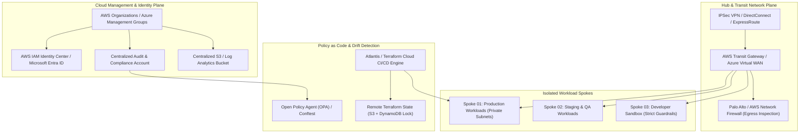

# Multi-Cloud Landing Zone & IaC Platform (`multi-cloud-landing-zone`)

[](https://pradeeptalari.me/projects/)
[](https://pradeeptalari.me/tools/repo-learning/)
[](https://pradeeptalari.me/projects/multi-cloud-landing-zone.html)
[](LICENSE)
[](SECURITY.md)
[](#-9-devsecops-governance-compliance-matrix)

Modular Terraform and Pulumi library establishing hardened AWS and Azure foundations to bootstrap isolated VPC topologies, zero-trust IAM, and transit gateways.

---

## 🏗️ Production Architecture Flow



---

## 🧠 Core Engineering & Architectural Principles

### 1. Zero-Trust Network Topologies & Microsegmentation
Enforces strict separation of concerns with dedicated Transit Gateways, central egress firewalls, and complete isolation between production and non-production environments.

### 2. Immutable Infrastructure as Code (IaC)
All cloud assets are provisioned exclusively through declarative Terraform and Pulumi modules with automated state locking in Amazon DynamoDB and storage versioning.

### 3. Shift-Left Policy as Code with Open Policy Agent (OPA)
Integrates automated pre-merge static policy evaluations via Conftest and Checkov, instantly preventing non-compliant security group ingress rules and unencrypted storage.

### 4. Centralized Identity & Ephemeral Session Access
Eliminates permanent root and IAM user credentials through AWS IAM Identity Center and Azure Entra ID single sign-on with automatic short-lived STS session credential harvesting.

### 5. Sovereign Multi-Region Disaster Recovery
Engineered for multi-region active-passive failover with automated KMS multi-region key replication, Route 53 health-checked DNS routing, and Cross-Region S3 replication.

---

## 💻 Infrastructure & Software Technology Stack

| Architectural Layer | Technology & Tools | Production Role |
|---|---|---|
| **IaC Engines** | HashiCorp Terraform 1.8+, Pulumi (TypeScript) | Declarative multi-cloud provisioning and resource state reconciliation |
| **Policy & Guardrails** | Open Policy Agent (OPA), Conftest, Checkov | Pre-flight static compliance checking and CIS benchmark enforcement |
| **Cloud Providers** | Amazon Web Services (AWS), Microsoft Azure | Multi-account management, Transit Gateway, and VPC/VNet peering |
| **GitOps CI/CD** | Atlantis, GitHub Actions, Terraform Cloud | Automated plan review on Pull Requests and lock enforcement |
| **Security & Telemetry** | AWS GuardDuty, CloudTrail, Azure Monitor | Continuous threat detection and centralized immutable audit logging |

---

## 🎯 Where to Use (Real-World Production Scenarios)

1. **Enterprise Cloud Migration Foundation**:
   -  Bootstrapping an isolated, multi-account AWS environment meeting SOC 2, HIPAA, and PCI-DSS standards in under 30 minutes.
2. **Multi-Tenant SaaS Infrastructure Partitioning**:
   -  Provisioning dedicated, isolated customer spokes with strict billing tagging and perimeter firewalling.
3. **Hybrid Data Center Interconnect**:
   -  Bridging on-premises VMware data centers to AWS and Azure using redundant IPSec VPN tunnels and Transit Gateways.
4. **Regulated Financial Services Hosting**:
   -  Hardening banking microservices with automated AWS Config remediation rules and immutable CloudTrail buckets.

---

## 🛠️ Step-by-Step SRE Deployment & Verification Runbook

### 1. Prerequisites
- Docker & Docker Compose (v2.20+)
- Python 3.10+ or Node.js 20+
- Git & GitHub CLI (`gh`)
- Valid cloud credentials (AWS / Azure / Kubernetes) if deploying live

### 2. Clone Repository
```bash
git clone https://github.com/Pradeeptalari14/multi-cloud-landing-zone.git
cd multi-cloud-landing-zone
```

### 3. Configure Safe Environment Template
```bash
cp .env.example .env
# Edit .env with your local or staging environment variables
```

### 4. Execute Automated Validation & Linting
```bash
bash scripts/validate.sh
```

### 5. Build & Launch Containerized Stack
```bash
docker compose up -d --build
# Verify health probe status
curl -s http://localhost:8000/health || echo "Service started"
```

---

## 🛡️ 9+ DevSecOps Governance Compliance Matrix

| Rule # | Requirement | Implementation in Repository | Status |
|---|---|---|---|
| **1** | **`README.md`** | Architecture DAG, core principles, technology stack, runbook, and compliance matrix | ✅ Complete |
| **2** | **`LICENSE`** | Permissive MIT Open Source License (Copyright © 2026 Talari Pradeep) | ✅ Verified |
| **3** | **`SECURITY.md`** | Vulnerability disclosure SLAs, supported versions, secret policies | ✅ Verified |
| **4** | **`.gitignore`** | Hardened against .terraform, *.tfstate, credentials, secret keys | ✅ Cleaned & Active |
| **5** | **`.env.example`** | Safe template with AWS/Azure subscription IDs, region tags, and state bucket names | ✅ Provided |
| **6** | **`.pre-commit-config.yaml`** | Terraform fmt/validate, tflint, Checkov, and Gitleaks hooks | ✅ Configured |
| **7** | **`.github/workflows/`** | Automated CI validation pipeline (sre-validation.yml) & Dependabot updates | ✅ Enabled |
| **8** | **`docs/ Knowledge Suite`** | TROUBLESHOOTING.md, GLOSSARY.md, COMPLIANCE.md | ✅ Documented |
| **9** | **`scripts/validate.sh`** | Automated Terraform linting, validation, and security checking script | ✅ Executable |
| **10** | **`CHANGELOG.md`** | Structured release notes following Keep-a-Changelog standard | ✅ Maintained |

---

*Synchronized with [Multi-Cloud Landing Zone & IaC Platform](https://pradeeptalari.me/projects/multi-cloud-landing-zone.html) & [Architecture Center](https://pradeeptalari.me/architecture/) — [Talari Pradeep Portfolio](https://pradeeptalari.me)*
