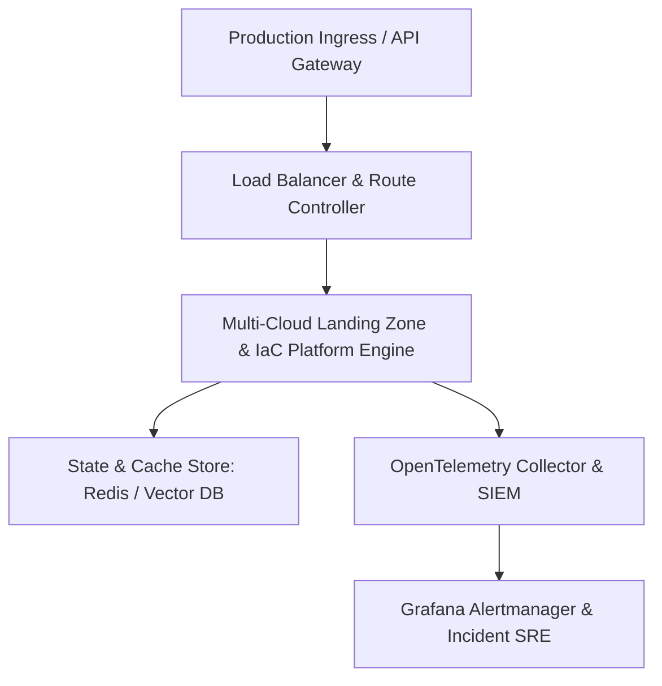

# 🚀 Multi-Cloud Landing Zone & IaC Platform

> Modular Terraform and Pulumi library establishing hardened AWS and Azure foundations to bootstrap isolated VPC topologies, zero-trust IAM, and transit gateways.

[](LICENSE)
[](SECURITY.md)
[](https://pradeeptalari.me/projects/)
[](https://pradeeptalari.me/tools/repo-learning/)
[](https://pradeeptalari.me/projects/multi-cloud-landing-zone.html)

---

## 🏗️ System Architecture Flow



---

## 🚀 Step-by-Step Onboarding & Deployment Runbook

### 1. Prerequisites
- Docker & Docker Compose
- Python 3.10+ or Node.js runtime
- GitHub CLI (`gh`) & Git CLI

### 2. Clone Repository
```bash
git clone https://github.com/Pradeeptalari14/multi-cloud-landing-zone.git
cd multi-cloud-landing-zone
```

### 3. Configure Environment Variables
```bash
cp .env.example .env
# Edit .env with your environment parameters
```

### 4. Install Dependencies & Validate
```bash
bash scripts/validate.sh
```

### 5. Run Execution Engine
```bash
# Docker Run
docker build -t multi-cloud-landing-zone:latest .
docker run --rm multi-cloud-landing-zone:latest
```

---

## 🛡️ DevSecOps & Governance Standards

This repository follows standard production repository governance:
- **Security Scans**: Pre-commit hooks for Gitleaks, ShellCheck, and YAML validation.
- **Vulnerability Disclosure**: Strict vulnerability reporting process via [SECURITY.md](SECURITY.md).
- **Contributing Guidelines**: Conventional commits and review standards documented in [.github/CONTRIBUTING.md](.github/CONTRIBUTING.md).

---

*Synchronized with [Multi-Cloud Landing Zone & IaC Platform](https://pradeeptalari.me/projects/multi-cloud-landing-zone.html) — [Talari Pradeep Portfolio](https://pradeeptalari.me)*
